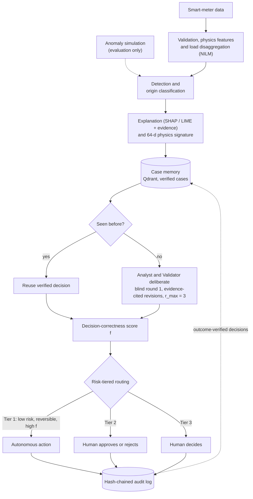

# EnergyMind

**A trust layer for smart-meter anomaly decisions.** EnergyMind detects, explains and diagnoses anomalies in neighbourhood smart-meter data. It then decides whether each decision can be automated or must go to a human, and it records every step in a tamper-evident audit log.

## How it works


## Installation

Requires Python 3.11 or 3.12.

```bash
git clone https://github.com/anonymous25anonymous255-wq/EnergyMind.git
cd EnergyMind
python -m venv .venv && source .venv/bin/activate     # Windows: .venv\Scripts\activate
pip install -e ".[all,dev]"                            # or pick extras: ml, deep, agents, db, viz
cp .env.example .env                                   # then fill in your keys
python -m energymind.config                            # validate configs/*.yaml
```


## Reproducing the pipeline

```bash
python -m energymind.io                                      # load + check against MANIFEST
python -m energymind.clean                                   # clean, quality mask
python -m energymind.splits                                  # temporal + household splits
python -m energymind.inject --prevalence 0.05 --seed 1       # inject anomalies + labels
python -m energymind.features                                # past-only features + NILM
python -m energymind.benchmark --prevalence 0.05 --seeds 1 2 3   # -> results/runs.jsonl
python -m energymind.benchmark_plots --prevalence 0.05 --seed 1  # -> results/figures/
python -W ignore -m energymind.explain --cases 6             # SHAP/LIME + evidence narratives
python -W ignore -m energymind.pipeline --n-val 40 --n-test 20   # decision layer -> results/m8_decision.json
```

Useful variants of the decision pipeline:

```bash
python -W ignore -m energymind.pipeline --n-val 40 --n-test 20 --human-answer approve        # batch tier-2 answers
python -W ignore -m energymind.pipeline --n-val 40 --n-test 20 --interactive-human-review     # answer review cards in the terminal
python -W ignore -m energymind.pipeline --qdrant --reset --n-val 40 --n-test 20              # use live Qdrant
python -m energymind.store --verify                                                          # verify the audit hash chain
```

## Tests and linting

```bash
pytest                      # unit tests, including no-label-leak and time-causality checks
ruff check src tests && ruff format --check src tests
```

## Repository structure

```
EnergyMind/
├── configs/                        # all settings live here
│   ├── agents.yaml                 # LLM backend, Analyst / Validator models, r_max
│   ├── data.yaml                   # paths, time handling, plausibility bounds, splits
│   ├── injection.yaml              # anomaly types, variants, prevalence, seeds
│   ├── models.yaml                 # detectors, hyperparameters, evaluation rules
│   ├── policy.yaml                 # action set, risk classes, tier thresholds, ε
│   └── store.yaml                  # Qdrant, audit backend, retrieval k / τ_sim
├── data/
│   ├── raw/MANIFEST.csv            # checksum of Austin_TX_US_2020.csv (data not versioned)
│   ├── injected/                   # labels_p{prevalence}_s{seed}.parquet
│   └── splits.json                 # temporal splits + held-out households
├── notebooks/
│   ├── 02_eda.ipynb                # exploratory analysis of the panel
│   ├── 03_injection_gallery.ipynb  # naive vs physics-consistent anomalies
│   ├── 04_benchmark.ipynb          # detector and classifier benchmark
│   └── 05_decision_demo.ipynb      # score f, routing, review cards, audit trail
├── results/
│   ├── runs.jsonl                  # one line per detector / seed / split
│   ├── m7_*.json                   # agent ablation and LLM smoke test
│   ├── m8_*.json                   # decision-layer runs (m8_decision.json = latest)
│   └── figures/                    # all generated plots
├── scripts/
│   ├── lock_env.py                 # writes requirements.lock
│   ├── m7_ablation.py              # rule vs LLM agents
│   └── smoke_m7_llm.py             # LLM backend smoke test
├── sql/schema.sql                  # append-only PostgreSQL audit schema
├── src/energymind/
│   ├── config.py · io.py           # config loading, raw data + manifest check
│   ├── clean.py · validate.py      # cleaning, quality mask, pandera schemas
│   ├── splits.py                   # temporal + household splits
│   ├── features.py · nilm.py       # past-only features, physics residuals, NILM
│   ├── inject/                     # anomaly simulation
│   │   ├── base.py                 # naive vs physics-consistent machinery
│   │   ├── data_quality.py         # bias, gain, drift, stuck-at, dropout, ...
│   │   ├── adversarial.py          # under-reporting, replay, mimicry
│   │   └── physical.py             # coherent peak, outage, voltage sag
│   ├── detect/                     # detectors behind one interface
│   │   ├── base.py · robust_z.py · rules.py · iforest.py · pyod_models.py
│   │   └── matrix_profile.py · lstm_ae.py · supervised.py · ensemble.py
│   ├── classify.py                 # LightGBM origin / type + isotonic calibration
│   ├── explain.py                  # TreeSHAP, LIME, evidence, narrative
│   ├── retrieval.py · records.py   # physics signature, "seen before?" check
│   ├── store.py                    # Qdrant memory + hash-chained audit log
│   ├── agents/
│   │   ├── analyst.py · validator.py   # rule-based agents (fallback)
│   │   ├── llm_agent.py                # Ollama / OpenAI-compatible backends
│   │   ├── deliberation.py             # blind round, cited revisions, convergence
│   │   └── prompts/                    # system prompts
│   ├── confidence.py               # decision-correctness score f
│   ├── policy.py                   # tier rule, threshold selection
│   ├── review.py                   # human review cards
│   ├── evaluate.py · benchmark.py  # event metrics and benchmark runner
│   ├── pipeline.py                 # end-to-end decision pipeline
│   ├── agent_pipeline.py           # agents-only routing demo
│   └── eda*.py · *_plots.py        # reports and figures
├── tests/                          # unit tests, incl. test_no_label_leak.py, test_time_causal.py
├── .env.example                    # Qdrant, Postgres, LLM keys (copy to .env)
├── docker-compose.yml              # local Qdrant + PostgreSQL
├── Makefile · tasks.ps1            # task runners (Linux/macOS · Windows)
└── pyproject.toml · requirements.lock
```

